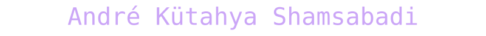
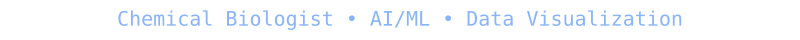
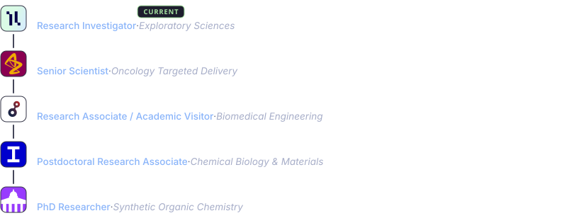
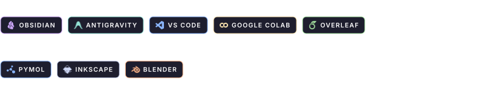

  
   
  

  &nbsp;
  &nbsp;
  

---

### 

Hey! I’m **André**, a chemical biologist who enjoys exploring important and challenging problems in biotherapeutic design. 

My foundational background is in organic chemistry, and an early fascination of mine was to utilise this to address significant challenges in biology, which in itself, is the most complex and important expression of chemistry.

I operate at the intersection of **peptide/protein engineering**, **drug discovery**, and **AI/ML**. My expertise spans bioconjugation, organic/polymer synthesis, and biomedical engineering, all focused on developing next-generation therapeutics and diagnostics. My central tenet is that an interdisciplinary approach, paired with state-of-the-art tools & resources, is the most effective way to overcome the longstanding challenges in biomedical research.

---

### 

  

---

### 

  

---

### 

In addition to research, I have a mild obsession with data visualisation & graphic design. I intend to use this space to share code for generating aesthetic graphs and provide vector-format representations of my favourite biotherapeutic modalities in a personally-designed aesthetic.

 
<ul>
  <li><b><a href="https://akshamsabadi.github.io/bioassay-LOD-fitter/">Bioassay LOD Fitter (v0.9.0)</a></b> (<a href="https://github.com/akshamsabadi/bioassay-LOD-fitter">Source Code</a>)</li>
</ul>
 

*(More repositories and visuals coming soon...)*

---

 

  

